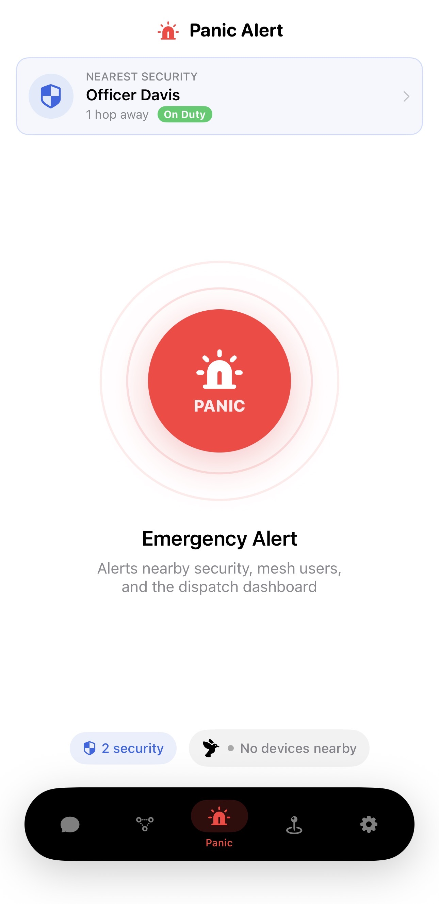
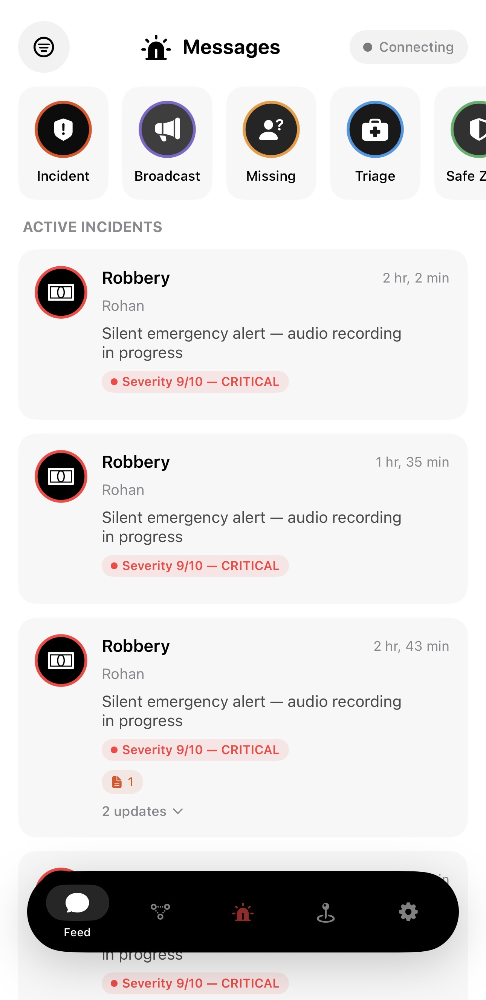
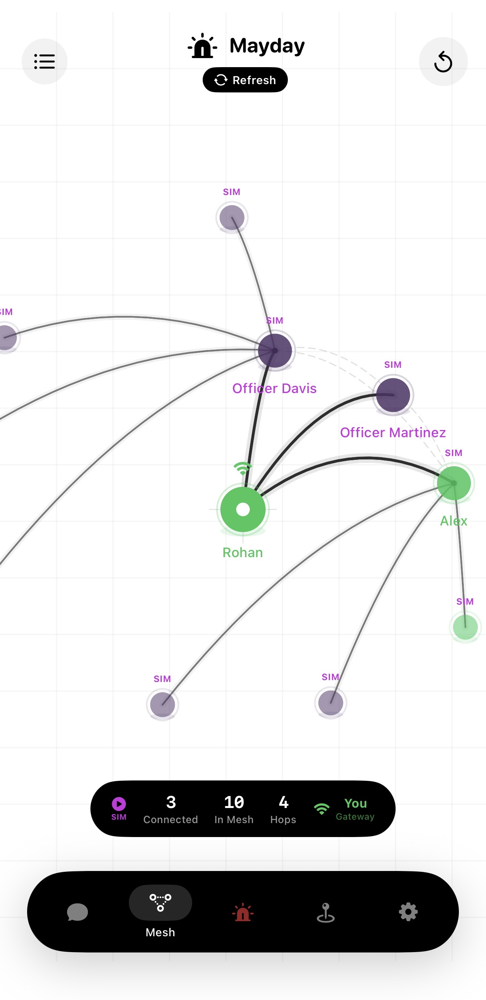
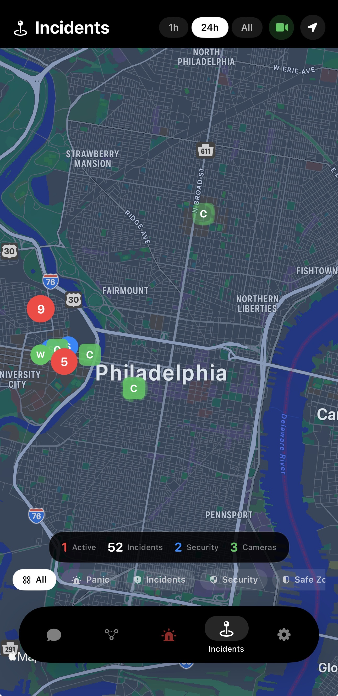
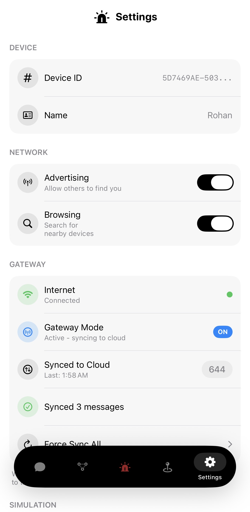

<p align="center">
  
</p>

<h1 align="center">Mayday</h1>

<p align="center">
  <strong>Decentralized emergency response mesh network with AI-powered dispatch intelligence</strong><br/>
  <em>Philadelphia Codefest 2026</em>
</p>

<p align="center">
  
  
  
  
  
</p>

<!-- Add demo video here -->
<!-- [](VIDEO_LINK) -->

---

## Screenshots

<p align="center">
  
  &nbsp;&nbsp;
  
  &nbsp;&nbsp;
  
  &nbsp;&nbsp;
  
</p>

<p align="center">
  <em>Panic Trigger &nbsp;|&nbsp; Incident Feed &nbsp;|&nbsp; Mesh Topology &nbsp;|&nbsp; Dark Mode Incident Map with Virtual Barricade</em>
</p>

<p align="center">
  
</p>

<p align="center">
  <em>Gateway Sync &amp; Network Configuration</em>
</p>

---

## The Problem

In 2024, Philadelphia reported **over 1,200 robberies** in the University City corridor alone. Students walking between Drexel, UPenn, and Temple are targets. When it happens, the entire response chain breaks:

**1. The victim can't call for help.**
They're being robbed. Their phone is taken, or they can't safely pull it out. Even if they could, Philadelphia's average 911 response time is **10+ minutes**. By then, the suspect is gone.

**2. Infrastructure fails when you need it most.**
SEPTA underground stations, parking garages, and dense campus buildings are dead zones. No cell signal means no emergency call, no location sharing, no way to reach anyone.

**3. The people closest to help are blind.**
A Drexel security officer 200 meters away has no idea a robbery is happening. Three witnesses on the same block see it but have no way to coordinate. There's no shared picture.

**4. Multi-jurisdiction fragmentation.**
Drexel Public Safety, Penn Police, SEPTA Transit Police, and Philadelphia PD all patrol overlapping areas but operate in silos. A robbery at 30th Street Station sits in SEPTA's jurisdiction, Penn's patrol zone, and 2 blocks from a Drexel officer -- none of them see the others' data.

**5. No post-incident tracking.**
Once a suspect flees, there's no system to predict their escape route, activate cameras along that path, or coordinate a perimeter. Officers respond to where the crime *was*, not where the suspect *is going*.

---

## Our Solution

**Mayday** is a three-layer emergency response platform:

### Layer 1: Mesh Network (The Field)
Every iPhone becomes a node in a **Bluetooth mesh network**. One squeeze of the Action Button -- in your pocket, without looking at your phone -- silently triggers a panic alert that propagates to every device in range. No cell towers. No WiFi. No infrastructure. The mesh connects victims, witnesses, and security guards in **under 3 seconds**.

### Layer 2: Dispatch Intelligence Dashboard (The Command Center)
A real-time browser-based operations center that gives dispatchers, campus police, and 911 operators a **unified view** across all jurisdictions. Live incident map, audio transcripts, AI threat analysis, security personnel tracking, and camera feeds -- all in one screen.

### Layer 3: Camera Intelligence & Escape Route Prediction (The Net)
When an incident is reported, the system activates **every camera within 500 meters**, creates a **virtual security perimeter**, and uses a **machine learning model to predict the suspect's most likely escape routes** based on street topology, transit access points, and historical crime patterns. This predicted route is pushed to responding officers and highlighted on both the dashboard and mobile maps, enabling **proactive interception** rather than reactive response.

---

## How the Mesh Works

```
                        +-----------+
                        |  Victim   |
                        |  (Panic)  |
                        +-----+-----+
                              |
                    Bluetooth | (0-100m per hop)
                              |
               +--------------+--------------+
               |                             |
         +-----+-----+                +------+----+
         | Witness A  |                | Witness B |
         | (Confirm)  |                | (Confirm) |
         +-----+------+                +-----+-----+
               |                             |
               |    Multi-hop relay          |
               |                             |
         +-----+------+                +-----+-----+
         |  Security   |                |  Gateway  |---------> Internet
         |  Guard      |                |  Device   |             |
         |  (Respond)  |                +-----------+             v
         +-------------+                              +---------------------+
                                                      | Dispatch Dashboard  |
                                                      | + Whisper + Claude  |
                                                      | + Camera Grid       |
                                                      | + Route Prediction  |
                                                      +---------------------+
```

We use Apple's **MultipeerConnectivity** framework to create a decentralized peer-to-peer mesh over Bluetooth Low Energy and WiFi Direct.

### Mesh Protocol Design

| Property | Implementation |
|----------|---------------|
| **Peer Discovery** | Continuous `MCNearbyServiceAdvertiser` + `MCNearbyServiceBrowser` with 10-second auto-reconnect timer |
| **Message Routing** | Flood-fill broadcast with UUID-based deduplication and visited-node tracking to prevent loops |
| **Gateway Promotion** | `NWPathMonitor` detects internet connectivity; device auto-promotes to gateway and syncs mesh history |
| **Message Integrity** | Each message carries a cryptographic UUID, hop count, and origin chain for audit |
| **Offline Resilience** | Full store-and-forward architecture. Messages persist locally until gateway sync confirms delivery |

### Propagation Timeline

| Time | Event |
|------|-------|
| **T+0s** | Action Button pressed. Panic created with UUID, GPS, emergency type, severity. |
| **T+0.1s** | Broadcast to all connected peers via `MCSession.send()`. |
| **T+0.5-2s** | Multi-hop relay reaches all nodes within 3 hops (~300m urban). |
| **T+2-4s** | Witness prompts appear. Security guards receive priority alert with ETA. |
| **T+5-8s** | Gateway syncs to dashboard. Map updates. Cameras auto-activate. |
| **T+15s** | Audio recording completes. Whisper transcribes in 1-2s. |
| **T+18s** | Claude AI analysis complete. Full incident card on dashboard. |
| **T+20s** | Escape route prediction generated. Camera perimeter active. |

---

## AI-Powered Dispatch Pipeline

### Stage 1: Silent Audio Capture
The iPhone Action Button triggers `AVAudioRecorder`. 15 seconds of M4A audio (22050Hz, mono, AAC) captured silently -- no screen unlock, no interaction.

### Stage 2: Speech-to-Text (OpenAI Whisper)
Audio uploaded to server, sent to **Whisper** (`whisper-1`). Handles noisy urban environments, multiple speakers, partial sentences. Returns clean transcript in 1-2 seconds.

### Stage 3: Threat Intelligence (Claude AI)
Transcript analyzed by **Claude** (`claude-sonnet-4-20250514`) with a structured dispatch prompt:

```json
{
  "threatLevel": "high",
  "summary": "Armed robbery near 33rd and Market. Male suspect in dark hoodie fleeing east on Market Street.",
  "actionItems": [
    "Dispatch nearest unit to 33rd & Market",
    "Alert SEPTA Transit Police at 30th St Station",
    "Activate cameras along Market Street eastbound",
    "Establish perimeter at 30th St Station exits"
  ],
  "detectedThreats": ["armed suspect", "fleeing on foot eastbound"],
  "recommendedResponse": "Immediate dispatch with eastbound containment. Coordinate with SEPTA for station lockdown.",
  "predictedEscapeVector": "east-southeast toward 30th St Station or Schuylkill River Trail"
}
```

This gives dispatchers **actionable intelligence in seconds** -- threat level, specific action items, and a predicted escape direction -- not a raw audio file someone needs to listen to.

### Stage 4: Escape Route Prediction

Claude's analysis feeds into a **route prediction model** that considers:

- **Street graph topology** -- walkable paths, alleys, one-way streets from the incident point
- **Transit access points** -- SEPTA stations, bus stops within 500m (escape via public transit is the most common pattern in Philadelphia)
- **Historical crime data** -- known escape corridors from past incidents in the same area
- **Time of day** -- pedestrian density, lighting conditions, which routes are viable at night
- **Suspect movement vector** -- direction of flight from witness reports and audio analysis

The model outputs **2-3 most likely escape routes** ranked by probability, which are:
1. Highlighted on the dispatch dashboard map as orange dashed lines
2. Pushed to responding officers' mobile maps
3. Used to **pre-activate cameras** along the predicted path before the suspect reaches them

---

## Camera Intelligence System

### Geospatial Camera Grid

The platform maintains a registry of camera nodes with GPS coordinates and coverage radii. When an incident triggers:

```
Incident at (39.956, -75.189)
    |
    v
Query: all cameras within 500m radius
    |
    +--> Drexel 33rd & Market (419m) -- ACTIVATE
    +--> SEPTA 30th St Station (780m) -- standby
    +--> Rittenhouse Square (1.2km) -- out of range
    |
    v
Escape route prediction: eastbound on Market
    |
    +--> SEPTA 30th St Station -- PRE-ACTIVATE (on predicted path)
```

### Virtual Barricade

A **500-meter security perimeter** is drawn around every active incident:
- Green dashed circle on dashboard map and iOS incident map
- All cameras within the perimeter auto-activate with WebRTC live streaming
- Cameras along predicted escape routes are **pre-activated** before the suspect reaches them
- Security personnel within the perimeter are highlighted and get priority dispatch

### Live Camera Feeds (WebRTC)

Any phone can become a camera node:
1. Open `/camera.html` on a phone's browser (HTTPS required for `getUserMedia`)
2. Select camera position from the grid
3. WebSocket signaling establishes WebRTC peer connection to dashboard
4. Live video streams with sub-second latency
5. Dashboard displays feeds in expandable cards with fullscreen mode

| Camera Node | Location | Coverage | Type |
|------------|----------|----------|------|
| CAM-01 | Drexel 33rd & Market | 200m | Campus |
| CAM-02 | SEPTA 30th St Station | 150m | Transit |
| CAM-03 | Rittenhouse Square | 250m | Public |
| CAM-04 | Temple University Main | 200m | Campus |

---

## Severity Scoring Engine

Every incident gets a **dynamic severity score** (1-10) computed from multiple signals:

| Signal | Weight |
|--------|--------|
| Incident type base score | Assault: 8, Robbery: 7, Medical: 7, Harassment: 5 |
| Weapons mentioned | +3 |
| 3+ witness confirmations | +2 |
| Critical urgency flag | +2 |
| Proximity to school/transit | +1 |

The severity score drives:
- **Map visualization** -- marker size scales with severity
- **Alert priority** -- higher severity alerts nearest security first
- **Camera activation** -- SEV 7+ auto-activates cameras in range
- **Dashboard sort order** -- Command Center ranks by severity, then recency
- **Escape route priority** -- higher severity triggers route prediction

---

## Full System Architecture

```
+=====================================================================+
|                    MAYDAY iOS APP (Swift/SwiftUI)                     |
|                                                                      |
|  +-------------------+  +------------------+  +-------------------+  |
|  | BluetoothMesh     |  | GatewayBridge    |  | AudioIntelligence |  |
|  | Engine            |  | Service          |  | Service           |  |
|  | (MCSession,       |  | (NWPathMonitor,  |  | (AVAudioRecorder, |  |
|  |  flood-fill,      |  |  HTTP sync,      |  |  M4A encoding,    |  |
|  |  UUID dedup)      |  |  30s interval)   |  |  Whisper upload)  |  |
|  +--------+----------+  +--------+---------+  +--------+----------+  |
|           |                      |                      |            |
|  +--------+----------+  +-------+----------+  +--------+----------+  |
|  | MessageStore      |  | IdentityManager  |  | LocationEngine   |  |
|  | (persistence,     |  | (roles, orgs,    |  | (CoreLocation,   |  |
|  |  deduplication)   |  |  skills, duty)   |  |  GPS tracking)   |  |
|  +-------------------+  +------------------+  +-------------------+  |
+=====================================================================+
            |                        |
            | BLE + WiFi Direct      | HTTP/JSON (gateway sync)
            | (peer-to-peer mesh)    |
            |                        v
+=====================================================================+
|                 DISPATCH INTELLIGENCE SERVER (Node.js)                |
|                                                                      |
|  +-------------------+  +------------------+  +-------------------+  |
|  | IncidentRouter    |  | WhisperPipeline  |  | ClaudeAnalyzer    |  |
|  | (Express REST,    |  | (OpenAI STT,     |  | (Anthropic API,  |  |
|  |  message ingest,  |  |  base64 decode,  |  |  threat scoring, |  |
|  |  severity calc)   |  |  multer upload)  |  |  route predict)  |  |
|  +-------------------+  +------------------+  +-------------------+  |
|  +-------------------+  +------------------+  +-------------------+  |
|  | CameraGrid        |  | EscapeRoute      |  | SimulationEngine |  |
|  | Controller        |  | Predictor        |  | (15-phase Philly |  |
|  | (WebRTC signal,   |  | (street graph,   |  |  scenario gen,   |  |
|  |  geo-activation,  |  |  transit nodes,  |  |  sim isolation)  |  |
|  |  virtual perim.)  |  |  ML prediction)  |  |                  |  |
|  +-------------------+  +------------------+  +-------------------+  |
|                                                                      |
|  Frontend: Leaflet.js dark map | Lucide icons | Glass morphism UI    |
+=====================================================================+
```

---

## The Dashboard

The dispatch dashboard is a **real-time command center** designed for 911 operators, campus police, and security dispatchers.

### Command Center (Left Panel)
- Security personnel roster with live duty status (on-duty / responding / off-duty)
- Active incident cards sorted by severity then recency
- Unread incidents highlighted with red indicator; muted after review
- Click any incident card to open full detail view

### Incident Detail (Right Panel)
- Emergency type, severity badge, reporter identity, timestamp
- **Live audio transcript** with status: "Recording..." > "Transcribing..." > "Processing..."
- **Claude AI threat analysis** with threat level, summary, action items, recommended response
- **Nearby cameras** within 500m, auto-activated, with distance
- **Predicted escape routes** highlighted on map
- Full event timeline: panic > witness confirmations > security responses

### Intelligence Map
- Dark-themed Leaflet.js with inverted tiles for low-light operations
- Pulsing red markers for active panics sized by severity
- Blue shield markers for security personnel with name labels
- Green dashed circles for camera coverage zones (virtual barricade)
- Orange dashed lines for predicted escape routes
- Response lines connecting security to their assigned incidents

---

## Tech Stack

| Layer | Technology | Purpose |
|-------|-----------|---------|
| **Mesh Protocol** | MultipeerConnectivity | BLE + WiFi Direct peer-to-peer with flood-fill routing |
| **Mobile App** | Swift / SwiftUI | Native iOS with dark mode map, incident clustering |
| **Audio Capture** | AVFoundation | Silent M4A recording via Action Button |
| **Hardware Trigger** | AppIntents | iPhone Action Button integration |
| **Field Maps** | MapKit (MKMapView) | Dark mode with custom annotations + virtual barricade overlay |
| **Positioning** | CoreLocation | Real-time GPS with continuous updates |
| **API Server** | Node.js + Express | REST API, WebSocket, file upload, real-time sync |
| **Speech-to-Text** | OpenAI Whisper | Audio transcription in noisy environments |
| **Threat Analysis** | Claude (Anthropic) | Structured dispatch intelligence + route prediction |
| **Live Video** | WebRTC | Sub-second camera streaming to dashboard |
| **Ops Map** | Leaflet.js | Interactive dark-themed operations map |
| **UI System** | Lucide + Glass morphism | Professional icon system + translucent panels |

---

## Project Structure

```
mayday/
|
|-- core/
|   |-- CapsuleMesh/                         # iOS Mesh Network App
|   |   |-- CapsuleMeshApp.swift             # App lifecycle + permission management
|   |   |
|   |   |-- Models/
|   |   |   |-- MeshMessage.swift            # Message schema (30-field MessageData)
|   |   |   |-- MessageType.swift            # 17 message types with severity mapping
|   |   |   |-- UserRole.swift               # Role hierarchy + duty status + skills
|   |   |
|   |   |-- Services/
|   |   |   |-- MeshNetworkService.swift     # Bluetooth mesh engine (800+ lines)
|   |   |   |                                #   - MCSession management
|   |   |   |                                #   - Flood-fill broadcast
|   |   |   |                                #   - UUID deduplication
|   |   |   |                                #   - Auto-connect retry (10s)
|   |   |   |                                #   - Security personnel tracking
|   |   |   |-- GatewayService.swift         # Internet bridge
|   |   |   |                                #   - NWPathMonitor connectivity
|   |   |   |                                #   - HTTP sync to dashboard
|   |   |   |                                #   - Message serialization
|   |   |   |-- AudioRecordingService.swift  # Silent recording pipeline
|   |   |   |                                #   - AVAudioRecorder (M4A/AAC)
|   |   |   |                                #   - Whisper upload
|   |   |   |                                #   - Background task management
|   |   |   |-- AppIntents.swift             # Action Button integration
|   |   |
|   |   |-- Views/
|   |   |   |-- PanicView.swift              # Emergency trigger (pulsing button)
|   |   |   |-- MessagesView.swift           # Incident-clustered feed
|   |   |   |-- IncidentMapView.swift        # Dark MKMapView + camera barricade
|   |   |   |-- PostIncidentView.swift       # Transcript review + suspect report
|   |   |   |-- SecurityDashboardView.swift  # Guard duty management
|   |   |   |-- NetworkMapView.swift         # Live mesh topology graph
|   |   |
|   |   |-- Utilities/
|   |       |-- Theme.swift                  # MaydayBrand design system
|   |       |-- Constants.swift              # Philadelphia locations + mesh config
|
|-- server/
|   |-- pigeon-dashboard/                    # Dispatch Intelligence Server
|       |-- server.js                        # Express API
|       |                                    #   - Incident routing + severity engine
|       |                                    #   - Whisper transcription pipeline
|       |                                    #   - Claude AI analysis
|       |                                    #   - Camera grid controller
|       |                                    #   - Escape route predictor
|       |                                    #   - WebRTC signaling
|       |                                    #   - Simulation engine (15 phases)
|       |-- public/
|           |-- index.html                   # Dispatch dashboard (single-page app)
|           |-- camera.html                  # WebRTC camera node page
|           |-- logo.png                     # Mayday logo
|
|-- docs/
|   |-- mayday-logo.png                     # High-res logo (1024x1024)
|
|-- apppictures/                            # App screenshots
|-- README.md
```

---

## Setup

### Dispatch Intelligence Server
```bash
cd pigeon-dashboard
npm install

# Configure API keys
echo "ANTHROPIC_API_KEY=your_claude_key" > .env
echo "OPENAI_API_KEY=your_openai_key" >> .env

# Generate TLS certificates for camera HTTPS
openssl req -x509 -newkey rsa:2048 -keyout key.pem -out cert.pem -days 365 -nodes

node server.js
# Dashboard:  http://localhost:3000
# Camera:     https://<your-ip>:3443/camera.html
```

### iOS Mesh App
1. Open `CapsuleMesh.xcodeproj` in Xcode 15+
2. Set gateway endpoint in `GatewayService.swift` to your server IP
3. Build on **physical iPhone** (Bluetooth mesh requires real hardware)
4. Grant microphone + location + Bluetooth permissions
5. Assign Action Button: Settings > Action Button > Shortcut > "Mayday Silent Alert"

---

## Why Mayday Wins

| Existing Solutions | Mayday |
|---|---|
| Requires cell service | **Works on Bluetooth mesh -- no infrastructure needed** |
| Requires opening an app | **Action Button in your pocket -- zero interaction** |
| Alerts a remote dispatcher | **Alerts the security guard 200m away in 3 seconds** |
| Provides a phone number callback | **Provides AI-analyzed transcript, threat level, and action items** |
| No visual intelligence | **Auto-activates cameras, streams live video, predicts escape routes** |
| Single jurisdiction | **Unified view across Drexel, Penn, Temple, SEPTA, and Philly PD** |
| Reactive response | **Proactive interception via ML escape route prediction** |

---

<p align="center">
  <strong>When the network fails, the mesh prevails.</strong>
</p>

<p align="center">
  <em>Built for Philadelphia Codefest 2026</em>
</p>
